<div align="center">

# iKhaya KZN

**Zulu heritage and a smart KwaZulu-Natal trip planner, in one Flask app.**

Trace your clan, explore herbs, foods and ceremonies, then plan a trip that adapts to the weather, the time of day and load-shedding.

[](https://travel-recommender-kzn.onrender.com/)
[](https://github.com/ntokozo078/travel-recommender-kzn/actions/workflows/tests.yml)
[](LICENSE)


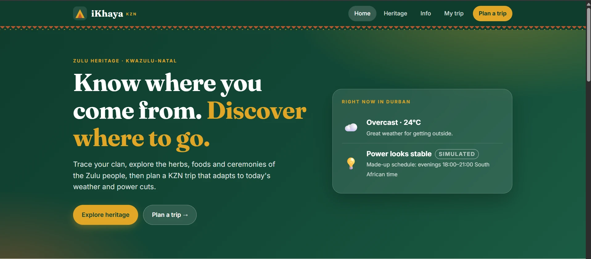

</div>

**Live demo:** <https://travel-recommender-kzn.onrender.com/> (free hosting: the first visit after a quiet spell can take about 30 seconds to wake up)

## Contents

- [What it is](#what-it-is)
- [Screenshots](#screenshots)
- [Features](#features)
- [How it works](#how-it-works) (system, request flow, ranking, data pipeline, data model, deployment)
- [Run it locally](#run-it-locally) · [Configuration](#configuration) · [Project layout](#project-layout)
- [API](#api)
- [Working with the data](#working-with-the-data)
- [Tests and CI](#tests-and-ci) · [Deploy](#deploy-render)
- [Data sources and limits](#data-sources-and-limits) · [Known limitations](#known-limitations)
- [Credits](#credits-and-attribution) · [License](#license)

## What it is

Two projects merged into one app:

- **Heritage explorer:** Zulu clans and izithakazelo (praise names), herbs, foods, rituals, dance, dress, beads and cultural places.
- **Trip planner:** about 950 places across KwaZulu-Natal (36 hand-picked plus roughly 900 from OpenStreetMap), ranked for the weather on the day you choose, the time of day, load-shedding and, if you share it, your location. Includes nightlife, entertainment, places to stay, a 7-day forecast and a printable itinerary.

It is built with a few firm rules:

- **Unknown stays unknown.** No invented prices, hours, ratings or history. A missing fact is hidden, never guessed.
- **Explainable ranking.** Every point added to or taken from a place appears as a chip on its card.
- **Tips, not verdicts.** The app shows general advice and listed ratings. It never calls a venue or an area safe or unsafe.
- **Honest about its data.** Load-shedding is *simulated* and says so wherever it is shown. Distances in "My trip" are straight-line and labelled approximate.

## Screenshots

<table>
  <tr>
    <td width="50%">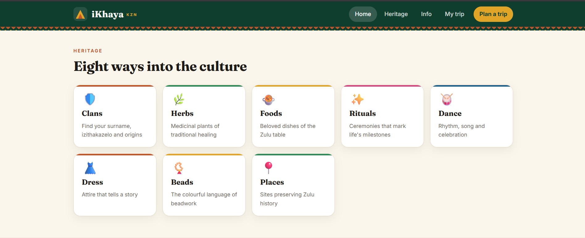<br><sub><b>Heritage.</b> Eight ways into the culture.</sub></td>
    <td width="50%">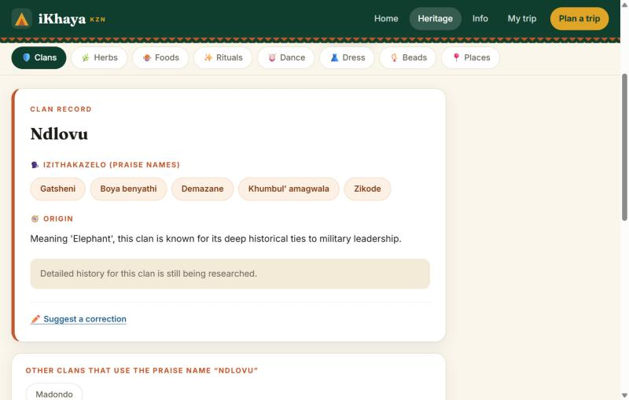<br><sub><b>Clan explorer.</b> Spelling-tolerant search, praise-name chips, "Suggest a correction".</sub></td>
  </tr>
  <tr>
    <td width="50%">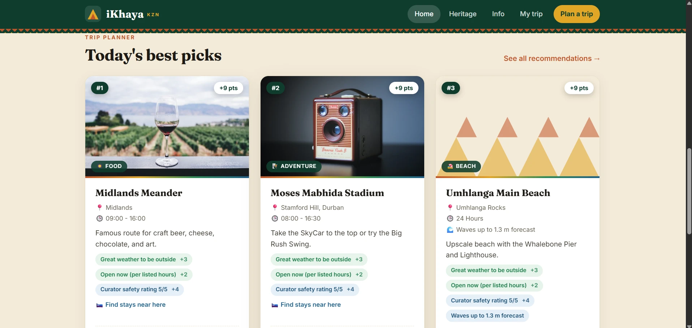<br><sub><b>Today's best picks.</b> Each card shows exactly why it ranked, with points.</sub></td>
    <td width="50%">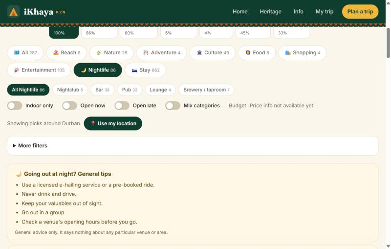<br><sub><b>Trip planner.</b> Pick a date, category, subcategory and filters; general night tips appear on nightlife results.</sub></td>
  </tr>
  <tr>
    <td width="50%">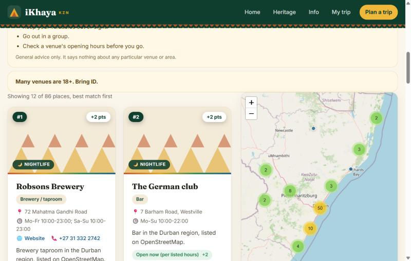<br><sub><b>Cards and map.</b> Details only when known; the map clusters every match.</sub></td>
    <td width="50%">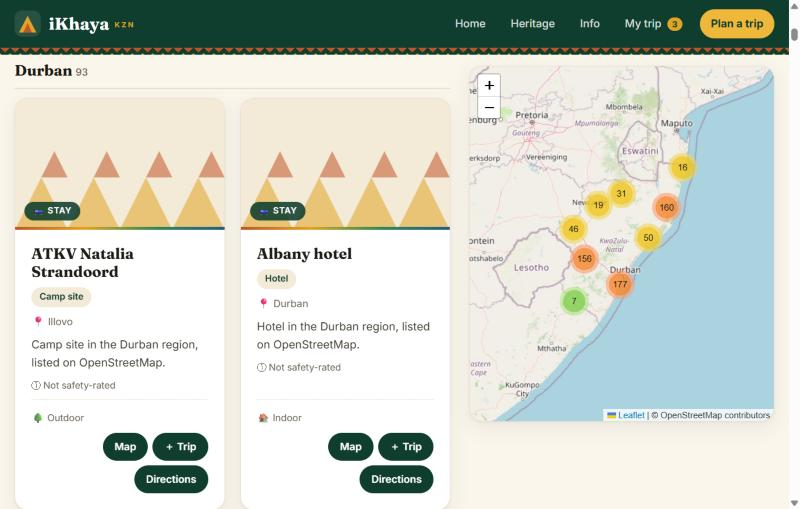<br><sub><b>Places to stay.</b> Hotels, guest houses, hostels, chalets and camp sites, grouped by region.</sub></td>
  </tr>
  <tr>
    <td width="50%">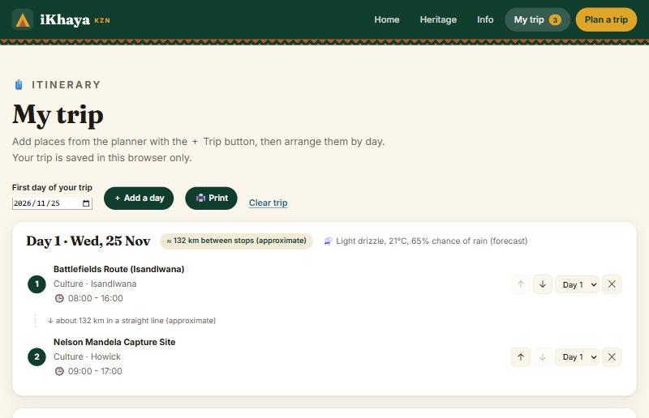<br><sub><b>My trip.</b> Group places by day; distances are labelled approximate; there is a print view.</sub></td>
    <td width="50%">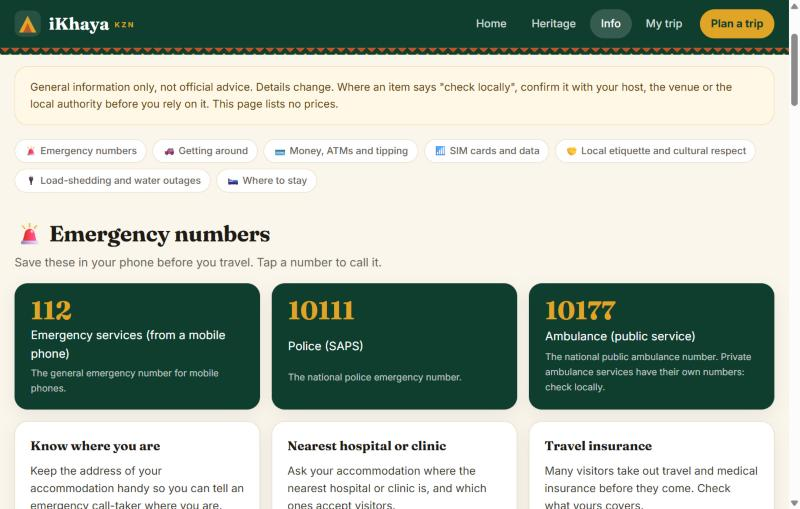<br><sub><b>Travel info.</b> Emergency numbers and general tips, with "check locally" where things vary.</sub></td>
  </tr>
</table>

<p align="center">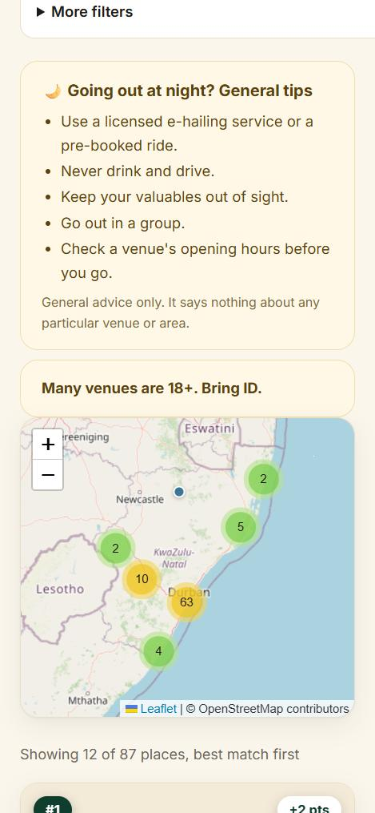<br><sub><b>On a phone.</b> The whole site works at phone width.</sub></p>

## Features

**Heritage**
- Clan explorer: search a surname or alternative spelling (Ntombela and Ntombella both work), "did you mean", autocomplete, and a reverse lookup that lists every clan sharing a praise name.
- Rich clan records (meaning, origin with a map pin, related clans, sources, a confidence badge) appear only where data exists; the page says plainly when a clan's history is still being researched.
- Herbs, foods, rituals, dance, dress, beads and cultural places, each searchable.

**Trip planner**
- Seven-day **date picker**: places are ranked for that day's forecast and weekday.
- **Time-of-day aware**: after 17:30 nightlife and evening entertainment rise, daylight spots drop, and "Open now" / "Open late" use the listed opening hours.
- Filters: category, subcategory, region, indoor only, price, vibe (nightlife, family, nature, culture, food, budget), what-if time, and **Mix categories** so one kind of place cannot fill the top results.
- **Waves** for beaches from marine forecasts; big waves cost points and say so.
- **Places to stay** by region and a "Find stays near here" map link on every card.
- A clustered **map** of every match.
- **My trip**: save places in your browser, arrange them by day, see approximate distances and each day's forecast, and print it.
- General **night-safety tips** and an "18+, bring ID" note on nightlife results.

**Practical**
- A travel-info page: emergency numbers (112, 10111, 10177), getting around, money and tipping, SIM cards, etiquette and cultural respect, load-shedding and water-outage tips.

**Under the hood**
- Explainable, rule-based ranking (no black box).
- Polite, cached, idempotent OpenStreetMap ETL for the whole province.
- Additive, recorded database migrations that never drop data.
- Per-page titles and descriptions, Open Graph tags, `robots.txt`, `sitemap.xml` and a no-JavaScript summary.
- About 1,700 test cases that never touch the network, and CI on every push.
- No build step and no front-end framework: plain JavaScript, with Leaflet from a CDN.

## How it works

### System overview

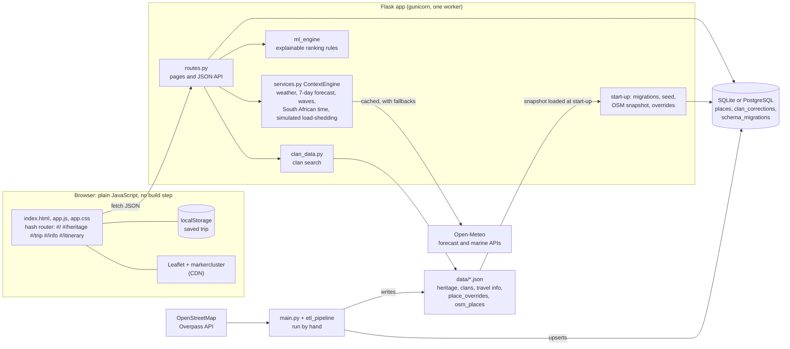

### What happens when you open the planner

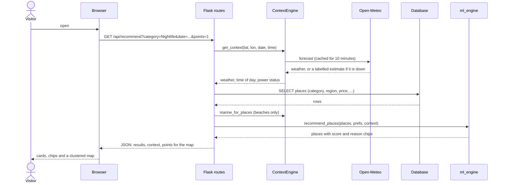

### How places are ranked

Every rule adds a **reason chip** that carries its points, and `score` is exactly the sum of the chips. Unknown facts (no safety rating, no hours, no price) never add or remove points.

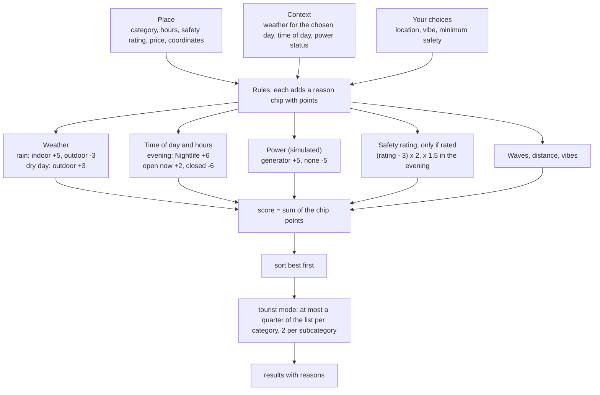

| Rule | Points |
|------|--------|
| Rain: indoor / outdoor | +5 / -3 |
| Dry daytime, outdoor place | +3 (no sunshine bonus after dark) |
| Load-shedding (simulated): has a generator / not | +5 / -5 |
| Evening (17:30 to 04:00 South African time): Nightlife | +6 |
| Evening entertainment: hours show it is open in the evening / a cinema, theatre, casino, comedy, music or events venue with no hours listed | +4 / +2 |
| Evening: Beach, Nature, Adventure | -4 |
| Daytime: Nightlife not listed as open now | -4 |
| Listed hours say open now / closed now | +2 / -6 |
| Curator safety rating (0-5): `(rating - 3) x 2`, times 1.5 in the evening; **not rated = no points** | varies |
| Beach waves forecast at 2.5 m or more | -3 (smaller waves are information only) |
| Distance from you (only when you share a location) | up to -6 |
| `vibe=`: matching category or subcategory, price for `budget`, "often 18+" for `family` | see `ml_engine/recommender.py` |

`tourist=1` (with category "All") keeps one category from filling the top results: at most a quarter of the list (3 of 12, 1 of 3) per category, and at most 2 places of one subcategory (so malls or cafes cannot fill a category's share). Food and Shopping places loaded from OpenStreetMap are capped at 150 per region and subcategory when they are imported. `at=21:30` previews another time of day and `date=` another day. Places to stay are kept out of the "All" ranking because a hotel is not a thing to do.

### Where places come from: the ETL

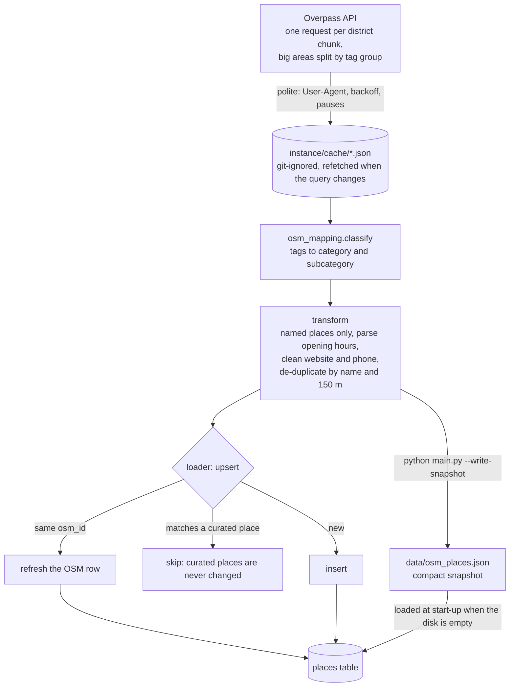

### Data model

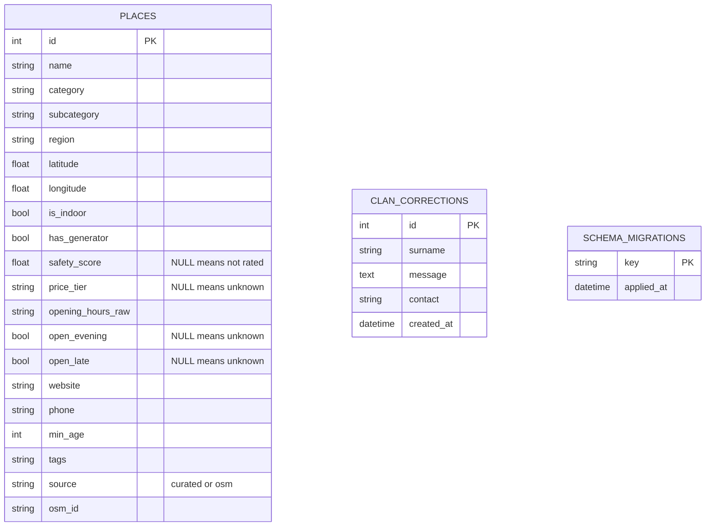

Clan data is not in the database: it is read from `data/surnames.json` (base list) and `data/clans_enrichment.json` (optional detail), merged and validated when the app starts.

### Deployment and CI

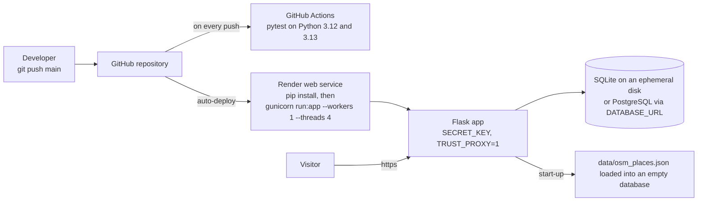

## Run it locally

```
git clone https://github.com/ntokozo078/travel-recommender-kzn.git
cd travel-recommender-kzn
pip install -r requirements.txt
python run.py
```

Open <http://127.0.0.1:5001>. The SQLite database is created, migrated and seeded automatically in `instance/ikhaya.db`, and the OpenStreetMap snapshot is loaded, so nothing else needs installing.

## Configuration

Settings come from environment variables or a local `.env` file (copy `.env.example`; never commit `.env`).

| Variable | Default | Purpose |
|----------|---------|---------|
| `SECRET_KEY` | `dev-only-change-me` | Flask secret. Set a long random value in production. |
| `DATABASE_URL` | local SQLite file | Use PostgreSQL (see [below](#postgresql-optional)). |
| `LOAD_OSM_SNAPSHOT` | `1` | Load `data/osm_places.json` at start-up. `0` skips it. |
| `TRUST_PROXY` | unset | `1` behind a reverse proxy (Render), so the real client IP and `https` are used. |
| `PORT` | `5001` | Port for `python run.py`. |
| `FLASK_DEBUG` | `1` | Debug mode for `python run.py` only (gunicorn ignores it). |

## Project layout

```
run.py                 start the server
config.py              settings (reads .env)
app/
  __init__.py          app factory: creates tables, runs migrations, seeds, loads the OSM snapshot
  routes.py            pages (+ robots.txt, sitemap.xml) and the JSON API
  services.py          weather, 7-day forecast, sea conditions, load-shedding (all with fallbacks)
  models.py, seed.py   Place model and the curated places
  migrations.py        additive, recorded start-up migrations (never drops anything)
  taxonomy.py          categories, subcategories, regions
  overrides.py         data/place_overrides.json (hand-maintained prices, hours, ratings)
  clan_data.py         clan records and search
  templates/index.html page shell, meta tags and the <noscript> summary
  static/css, static/js  the front end (hash-routed, no build step)
ml_engine/             explainable scoring rules (weather, time of day, power, safety, waves, vibes)
etl_pipeline/          OpenStreetMap -> clean -> database (overpass, osm_mapping, pipeline, loader, regions)
data/                  heritage JSON, info.json, clan enrichment, osm_places.json (the ETL snapshot)
docs/screenshots/      the images in this README
scripts/               check_images.py (reports broken image links)
tests/                 pytest suite (temporary databases, no network)
.github/workflows/     CI: runs pytest on every push
main.py                run the ETL
seed_data.py           wipe and re-seed the database
setup_db.py            optional: create the PostgreSQL database
```

## API

| Route | Purpose |
|-------|---------|
| `GET /api/heritage/<section>` | `clans`, `herbs`, `foods`, `rituals`, `dance`, `dress`, `beads`, `places` |
| `GET /api/recommend` | `category`, `limit`, `indoor=1`, `price=$\|$$\|$$$` (up to this tier; unknown prices excluded), `vibe=nightlife\|family\|nature\|culture\|food\|budget` (up to 3, comma-separated), `tourist=1` (mix categories), `at=HH:MM` (what-if time, South African time), `date=YYYY-MM-DD` (rank for that day's forecast, today to 6 days ahead), `subcategory=`, `region=`, `open_now=1`, `open_late=1`, `points=1` (all matches for the map), `lat`+`lon`, `min_safety`, `loadshedding=auto\|on\|off` |
| `GET /api/forecast?lat=&lon=` | the next 7 days of weather for a point (the planner's date picker) |
| `GET /api/info` | practical travel info for visitors (`data/info.json`) |
| `GET /api/filters` | filter values the data supports, with counts: price tiers, subcategories per category, regions |
| `GET /api/context` | current weather + power status |
| `GET /api/categories` | categories with place counts |
| `GET /api/heritage/clans/search?q=` | clan by surname or spelling (tolerant), "did you mean", praise-name reverse lookup |
| `GET /api/heritage/clans/suggest?q=` | autocomplete |
| `GET /api/heritage/clans/<surname>` | full clan record (base + enrichment, related clans as links) |
| `GET /api/places/near?lat=&lon=&limit=` | nearest places to a point (used for "near the clan's origin"); hotels are left out unless `include_stays=1` |
| `POST /api/clan-corrections` | "Suggest a correction" (JSON; stored for review; 5 per hour per IP) |
| `GET /healthz` | health check |
| `GET /robots.txt`, `GET /sitemap.xml` | for search engines (see [Search engines and sharing](#search-engines-and-sharing)) |

`/travel` and `/view_results` redirect to the Plan a trip page for old links.

Example:

```
GET /api/recommend?category=Nightlife&at=22:00&open_now=1&limit=3
```

Each result carries the place's fields, a `score`, and `reasons` (a list of `{text, tone, points}`) that add up to the score.

## Working with the data

### Clan entries

Two files, two jobs:

- `data/surnames.json` is the base list (surname, praise names, one-line origin). Don't reformat it.
- `data/clans_enrichment.json` is the optional extra detail, keyed by surname. This is the file you edit.

To add detail for a clan, add (or fill in) its entry. The key must match a surname in `surnames.json` (case and accents don't matter). **Every field is optional: leave it `null` unless you have a source.** Wrong heritage data is worse than missing data, and the page hides anything that is empty.

```json
"Surname": {
  "alt_spellings": ["Other spelling"],
  "izithakazelo_notes": [{ "name": "Praise name", "note": "What it refers to" }],
  "meaning": null,
  "ancestor": null,
  "origin": { "summary": null, "region": null, "lat": null, "lng": null, "migration_note": null },
  "related_clans": ["Another Surname"],
  "taboos_or_totem": null,
  "notable_people": ["Name"],
  "today_found_in": ["Place"],
  "sources": ["Book, author, year", "https://link"],
  "confidence": "oral-tradition"
}
```

| Field | Notes |
|-------|-------|
| `confidence` | `verified` (needs at least one source), `oral-tradition` or `unverified` |
| `origin.lat` / `origin.lng` | decimal degrees, both or neither; enables the map pin and "Places near the clan's origin" |
| `alt_spellings` | searchable; also tried for spelling tolerance (Ntombela / Ntombella already match) |
| `related_clans` | must be surnames in `surnames.json`; shown as clickable links |

The app checks the file when it starts and prints a `clan data:` warning for unknown fields, bad coordinates, wrong value types, `verified` without sources, unknown related clans and so on. A bad value is ignored; it never stops the app. The three entries shipped in the file are empty format demos.

Corrections sent from the page are saved in the `clan_corrections` table (surname, message, optional contact). Read them with any SQLite viewer, or `ClanCorrection.query.all()` in a Flask shell. Note that `python seed_data.py` drops every table, including this one.

### Place facts: prices, hours, safety ratings

Prices are never guessed: a place shows a price tier only when one is known. To add facts you can source, edit `data/place_overrides.json` (keyed by exact place name):

```json
{ "Place Name": { "price_tier": "$$", "safety_score": 4.2, "opening_hours": "09:00 - 17:00" } }
```

Other fields you can set the same way: `subcategory`, `region`, `website`, `phone`, `min_age`, `open_evening`, `open_late`, `opening_hours_raw`, `tags`. Unknown is always `null` and is never shown. The file is applied at every start and is safe to re-run; invalid values are ignored with a warning in the log.

- **Categories:** Beach, Nature, Adventure, Culture, Food, Shopping, Entertainment, Nightlife, Stay (list and subcategories in `app/taxonomy.py`; subcategories are stored as slugs such as `nightclub`).
- **Regions:** Durban, North Coast, South Coast, Midlands, Drakensberg, Zululand, Pietermaritzburg, Other KZN.
- **Safety:** `safety_score` is a 0-5 rating you supply. `null` means "not rated": it adds or removes no points and is never treated as neutral or unsafe. The app shows tips and ratings, never a verdict.
- **Upgrading an existing database:** on start-up the app adds any missing columns (`app/migrations.py`, `ALTER TABLE ... ADD COLUMN`). It never drops tables or deletes rows, and each step is recorded in `schema_migrations` so it runs once.

Dead image links can be listed with `python scripts/check_images.py [--heritage]` (read-only; it changes nothing).

### Travel info page

`data/info.json` holds the text of `#/info`. It is deliberately general: no prices and no other phone numbers, and anything that can vary says "check locally" (a test enforces this). Edit the file to change the page.

### Add more places (ETL: all of KwaZulu-Natal)

```
python main.py                              # use cached results younger than 7 days, fetch the rest
python main.py --regions Durban,Midlands    # only some regions (or chunk names)
python main.py --refresh                    # ignore the cache and ask Overpass again
python main.py --offline                    # cache only, no network
python main.py --dry-run                    # print the summary, change nothing
python main.py --write-snapshot             # also write data/osm_places.json (see below)
python main.py --from-file FILE             # a saved cache file, or the old durban_candidates.json
```

- **Source:** OpenStreetMap through the public Overpass API (no key). The province is covered by querying each district boundary in turn (`etl_pipeline/regions.py`, which also maps districts to your regions, so edit it there). One request at a time, a User-Agent, retries with backoff, and a pause between requests. Raw results are cached in `instance/cache/` (git-ignored), so re-runs make no requests while the cache is fresh. Cached results made by an older query are detected and refetched automatically.
- **What it pulls:** food and shopping (amenity restaurant, cafe, fast_food, food_court, ice_cream, marketplace; shop mall, department_store, supermarket, craft, gift, souvenir, with at most 150 places per region and subcategory, keeping the best-described), amenity nightclub, bar, pub, cinema, theatre, casino, arts_centre, events_venue, biergarten; leisure bowling_alley, ice_rink, amusement_arcade, miniature_golf, water_park, trampoline_park, escape_game, dance; tourism theme_park, zoo, aquarium, attraction, museum, gallery, and the places to stay hotel, guest_house, hostel, chalet, camp_site; sport=karting. Unnamed features are skipped, and so are apartments, motels and caravan sites.
- **What it stores:** category and subcategory from the tags (`etl_pipeline/osm_mapping.py`), the original opening-hours text, website, phone and `min_age` when tagged, and `open_evening` / `open_late` only when the hours text proves them (otherwise unknown). Safety and price are never set.
- **Safe to repeat:** places are matched by OSM id, then by name within 150 m. Re-running never duplicates, and curated places are never changed. It prints a summary by region and category so you can see coverage gaps.
- **Deployed copy:** hosts with a throw-away disk start empty, so a complete run is saved with `--write-snapshot` as `data/osm_places.json` and loaded at start-up (`LOAD_OSM_SNAPSHOT=0` turns that off). It is only written from a full run of every chunk.

### Area notes (optional SAPS context)

An optional, neutral "About this area" note can appear on place cards. It needs a file **you** download from the South African Police Service (station crime statistics). Nothing is scraped and nothing is bundled.

```
# 1. save the SAPS file as CSV in data/raw/ (git-ignored)
# 2. build the context file (one polite Overpass request for police station positions, cached)
python scripts/build_safety_context.py
python scripts/build_safety_context.py --input data/raw/saps.csv --categories robbery,burglary
```

- **CSV layout:** a station column, a category column and either a count column (long format) or one column per period such as `2023/2024` (wide format; the latest is used). See `etl_pipeline/safety.py`. Rows without a numeric count are skipped, never turned into zero.
- **Matching:** a SAPS station is attached to a map position only when its name matches an OpenStreetMap police station exactly (after removing words like "police station"). Names that match nothing, or two OSM stations, are listed and left out. Coordinates are never guessed.
- **Output:** `data/safety_context.json` (raw counts per station, source and period). When the file is absent the app simply shows no area notes.
- **In the app:** places within 15 km of a matched station get an optional `area_awareness` object in the API and a collapsed note on the card, with the source and period in the footer. It never changes a score or `safety_score`, and it is not a safety rating: the counts are not adjusted for population or visitors and say nothing about a venue.

## Tests and CI

```
pip install pytest
python -m pytest
```

Tests use a temporary database and made-up data, and they never touch the network or `instance/ikhaya.db` (a guard makes any outside call fail like an outage, so the fallbacks are tested too). They cover the recommender rules, the API shapes, the ETL mapping from a fixture file, and upgrading the oldest database schema without losing data. `.github/workflows/tests.yml` runs the suite on every push and pull request.

## Deploy (Render)

Web service, Python runtime:

| Setting | Value |
|---------|-------|
| Build command | `pip install -r requirements.txt` |
| Start command | `gunicorn run:app --workers 1 --threads 4 --bind 0.0.0.0:$PORT` |
| Health check path | `/healthz` |
| Environment | `SECRET_KEY` (any long random string), `TRUST_PROXY=1` |

Keep `--workers 1`: the SQLite database seeds itself on first start and the correction rate limit is kept in memory. Render's free-tier disk is ephemeral, so stored corrections are lost on each redeploy; set `DATABASE_URL` to a Render PostgreSQL database (and add `psycopg2-binary` to requirements) to keep them.

### PostgreSQL (optional)

```
copy .env.example .env      # then set DATABASE_URL
pip install psycopg2-binary
python setup_db.py
python run.py
```

## Data sources and limits

| What | Where it comes from | Limits |
|------|--------------------|--------|
| Heritage content | `data/*.json` (herbs, foods, culture, places, surnames) | Public-heritage summaries. Clan histories vary between families and regions; unknown detail is left empty, never guessed. |
| Curated places | `app/seed.py` | 36 hand-picked places. Safety ratings are the curator's own (not rated = no rating); prices are unknown until set in `data/place_overrides.json`. Some image links are dead (`scripts/check_images.py` lists them) and show a placeholder. |
| Other places | [OpenStreetMap](https://www.openstreetmap.org/copyright) contributors, via the Overpass API, under the [ODbL](https://opendatacommons.org/licenses/odbl/) | Volunteer-made: venues can be missing, closed or out of date, coverage varies by town, and opening hours, websites and phone numbers are often absent. `data/osm_places.json` is a derived database and stays under the ODbL. The footer credits OpenStreetMap. |
| Weather, 7-day forecast, waves | [Open-Meteo](https://open-meteo.com/) (no key). Sea data only exists for coastal points. | Forecasts are forecasts. If the service is down the app says so and ranks for today with an estimate. The free API is for non-commercial use: check Open-Meteo's terms before using this commercially. |
| Load-shedding | **Simulated** (a made-up evening schedule), labelled wherever it is shown | No live Eskom feed is connected. |
| Travel info | `data/info.json` | General facts only, no prices or other phone numbers; anything that can vary says "check locally". Not official advice. |
| Distances in "My trip" | Straight-line (great circle) | Approximate and labelled so: not driving distances or times. |
| Area notes (optional) | A SAPS crime-statistics file you download yourself, matched to OpenStreetMap police stations | Only present when you build `data/safety_context.json`. Raw counts per police station, not per venue, not adjusted for population or visitors; stations whose names do not match exactly are left out. Source and period are shown in the footer. |
| Region grouping | `etl_pipeline/regions.py` | A district-level approximation (e.g. "Drakensberg" is two whole districts). Edit it to change the grouping. |

The app shows tips and ratings, never a verdict that a venue or area is safe or unsafe.

## Search engines and sharing

- Every view sets its own page title and description as you move around, and the page carries Open Graph tags, a canonical link, `robots.txt` and `sitemap.xml`. Without JavaScript, a server-rendered summary (heritage sections, place counts, emergency numbers) is shown instead of an empty page.
- **Limit:** the app's views live after the `#` in the address (`#/info`, `#/trip`...). Search engines and link scrapers ignore that part, so they see one page, and the sitemap lists one URL. Indexing each view separately would need path URLs (`/info`, `/trip`) instead of `#`, which would change the URL scheme.
- There is no preview image yet (`og:image`).

## Known limitations

- Load-shedding is simulated; there is no live Eskom data.
- OpenStreetMap coverage is uneven: many venues have no opening hours, so the "Open now" and "Open late" filters can look short.
- Straight-line distances only: there is no routing service.
- Free hosting sleeps when idle and has an ephemeral disk, so corrections submitted by visitors are lost on each redeploy unless you add PostgreSQL.
- Search engines see one page, because views live behind the `#`.
- Some curated-place image links have gone dead and show a placeholder.

## Credits and attribution

- Place data: [OpenStreetMap](https://www.openstreetmap.org/copyright) contributors, available under the [Open Database Licence](https://opendatacommons.org/licenses/odbl/).
- Area notes (when enabled): South African Police Service (SAPS) crime statistics, with police station positions from OpenStreetMap.
- Weather, forecast and marine data: [Open-Meteo.com](https://open-meteo.com/) (CC BY 4.0).
- Maps: [Leaflet](https://leafletjs.com/) and [Leaflet.markercluster](https://github.com/Leaflet/Leaflet.markercluster), with OpenStreetMap tiles.
- Fonts: Fraunces and Inter from Google Fonts (SIL Open Font License).
- Heritage content is public-heritage summaries; see the attribution line on each card.

## License

[MIT](LICENSE) for the code and the original content of this project.

Not covered by it: OpenStreetMap-derived data (`data/osm_places.json`) stays under the [ODbL](https://opendatacommons.org/licenses/odbl/); third-party images and links remain their owners'; and Leaflet, Leaflet.markercluster and the fonts keep their own licenses.
